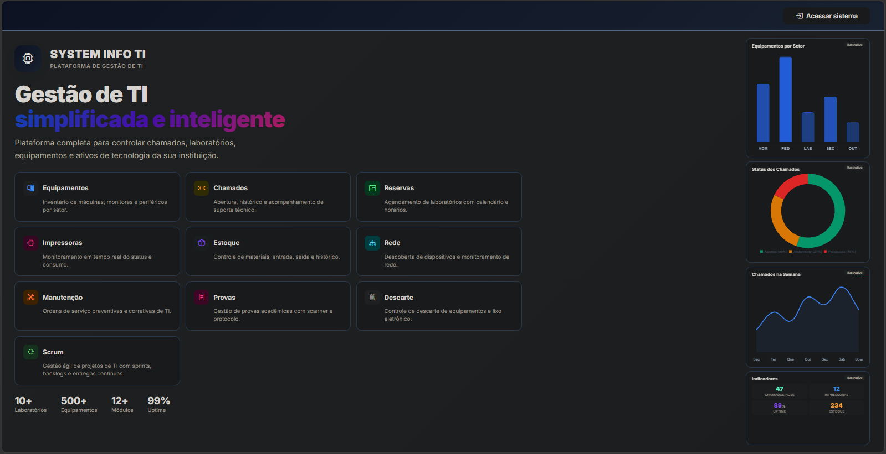
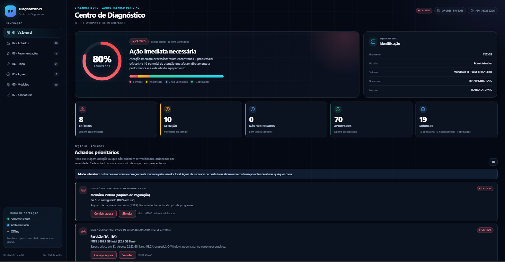

# Welington Santiago

**Analista de Infraestrutura de TI · Desenvolvedor Python**

Construo sistemas que resolvem operação real: gestão de parque de máquinas, diagnóstico de causa raiz em hardware, plataformas web com backend Flask e banco relacional, e automação de rotinas que ninguém deveria fazer à mão. Atuo nas duas pontas — a infraestrutura onde o software roda e o código que roda nela.

**Python** é minha linguagem principal. **C++** entra quando o problema exige proximidade com o sistema.

---

## Competências técnicas

| Área | O que domino |
| :--- | :--- |
| **Linguagens** | Python (principal), C++, SQL, PowerShell |
| **Backend e APIs** | Flask (blueprints, sessão, CSRF), APIs REST, integração com serviços de terceiros (Telegram Bot API, Binance, B3, ViaCEP) e com agentes via MCP |
| **Banco de dados** | SQL Server (pyodbc, migrações idempotentes) e MySQL — modelagem, consultas, índices e persistência de dados operacionais |
| **Infraestrutura Windows** | Diagnóstico de causa raiz em hardware, Registro e políticas de navegador, cofres de credenciais, NTP, licenciamento KMS, redes TCP/IP e cálculo de sub-redes |
| **Monitoramento** | SNMP para impressoras de rede, coleta de métricas de CPU, disco, memória, bateria e temperatura |
| **Automação** | Scripts de manutenção de parque, rotinas agendadas em background, execução silenciosa e correção assistida com elevação por UAC |
| **Dados e visão computacional** | Pandas, OCR local com Tesseract e OpenCV, processamento de áudio, relatórios em PDF e Excel |
| **DevOps e qualidade** | Docker e docker-compose, GitHub Actions (CI), Git, PyInstaller, pytest com mais de 200 testes de regressão |

---

## Sistemas em produção

> Os sistemas rodam sobre dados de instituição, credenciais e regras de negócio — por isso o código é privado. Arquitetura e trechos podem ser apresentados em entrevista; acesso ao repositório é liberado sob solicitação.

### System Info TI — gestão de TI de uma instituição de ensino

**Problema:** parque de **~400 máquinas e cerca de 500 equipamentos de TI**, em 12 laboratórios e nos setores administrativos, controlado em planilhas: chamado por telefone sem histórico, reserva de laboratório em papel, estoque sem rastro e impressão sem contador.

**Solução:**
- Helpdesk com abertura por setor, acompanhamento e histórico por usuário
- Reserva de laboratórios por horário oficial, com mapa dos labs e consulta de disponibilidade
- Agendamento de avaliações e conferência de impressão
- Inventário de equipamentos com etiqueta QR e código de barras gerados localmente
- Controle de estoque, movimentação de materiais e descarte de equipamentos
- Monitoramento de impressoras de rede por **SNMP**, com leitura de contador de páginas
- Gestão de IPs, perfis e permissões por papel
- Dashboard operacional, exportação em PDF e Excel, log de auditoria com rotação e trava de tentativas de login

**Decisões técnicas:**
- **16 blueprints** e **70 templates** — domínio separado por módulo, não um `app.py` monolítico
- SQL Server via **pyodbc**, com script de migração **idempotente** (roda quantas vezes for preciso sem dano)
- **waitress** como servidor de produção, não o servidor de desenvolvimento do Flask
- **Threat model e plano de remediação documentados** antes da exposição na rede

**Stack:** Python · Flask · SQL Server · pyodbc · waitress · reportlab · pandas · openpyxl · pysnmp · pydantic · PyInstaller

*Painel inicial do System Info TI — gráficos em modo ilustrativo, sem dados reais de instituição.*

### DiagnosticoPC — diagnóstico de causa raiz e reparo assistido

**Problema:** o técnico de bancada recebe uma máquina "lenta e travando" e gasta horas em teste manual até achar a causa — ou troca a peça errada, e o orçamento vira retrabalho.

**Solução — 26 módulos de análise:**
- **Throttling oculto:** identifica CPU travada em 0,79 GHz por BD-PROCHOT, fonte sem pino de identificação ou problema térmico
- **Motor de gargalo:** cruza disco mecânico rodando Windows 10/11 com RAM em single channel
- **Ameaças ocultas:** detecta `svchost.exe` executando fora de `System32`, tráfego em portas de mineração e sequestro do arquivo `HOSTS`
- **Auditoria de SSD:** valida TRIM e SMART e executa micro-benchmark de escrita sequencial
- **Falhas de driver (PnP):** varre códigos 43, 10 e 28 do Gerenciador de Dispositivos
- **Laudo pericial em HTML** somente leitura, com tema de painel em CSS puro — sem JavaScript, fonte ou imagem externa
- **Servidor local com correção assistida:** cada achado com reparo mapeado ganha botão de correção; a execução exige CSRF, valida o Host local e pede segunda confirmação em risco alto; ações administrativas sobem por **UAC** em processo elevado
- **Servidor MCP** para expor o diagnóstico a agentes automatizados
- **Manifesto de integridade por hash** das ferramentas e build executável

**Stack:** Python · psutil · ttkbootstrap · Flask (servidor local) · HTML/CSS · MCP · PyInstaller · pytest (202 testes de regressão)

*Laudo em execução na bancada: 80% de aprovação, 8 achados críticos e 10 de atenção, com ação de correção por achado.*

### Outros sistemas

**🏦 Nexus Financeiro — SaaS de gestão financeira**
Assinatura recorrente, robô bidirecional no Telegram, OCR local (Tesseract + OpenCV) para leitura de notas fiscais sem enviar imagem para fora, lançamento por áudio, painel administrativo e relatórios em PDF e Excel.
**Stack:** Python · Flask · SQL Server · Telegram Bot API · Tesseract · OpenCV · Pandas

**🛡️ Blindagem e filtro de leads**
Validação geográfica por CEP via ViaCEP antes de liberar o cadastro, proteção de sessão contra uso simultâneo da mesma conta e persistência em MySQL.
**Stack:** Python · Flask · MySQL · ViaCEP

**⚙️ Automação de laboratórios (CPD)**
Scripts em Python e C++ que calculam IPs, aplicam políticas de navegador via Registro, limpam cofres de credenciais, sincronizam NTP e automatizam licenças KMS — execução silenciosa, em máquinas em uso.
**Stack:** Python · C++ · Windows Registry · PowerShell · TCP/IP

**📊 Monitoramento de mercado e APIs**
Rotinas em background com `BackgroundScheduler` sobre B3 e Binance, detecção de volatilidade, alertas e tratamento de falha de API.
**Stack:** Python · Pandas · BackgroundScheduler · APIs B3 e Binance

---

## Sobre o código

Todo o código dos sistemas acima é **privado**. Este perfil mostra apenas a apresentação do trabalho — não há repositório de código público. Acesso pode ser concedido pontualmente, sob solicitação e mediante autorização.

Dossiê técnico com arquitetura, decisões e evidências: **disponível sob solicitação**.

---

## Práticas de engenharia

- **Testes de regressão** — suíte com mais de 200 testes, executada em CI a cada push.
- **Migração idempotente** — script de banco que pode rodar repetidas vezes sem corromper dado.
- **Segurança por padrão** — CSRF em endpoints administrativos, validação de Host, elevação explícita por UAC e threat model documentado.
- **Ambiente reprodutível** — Docker e docker-compose; sem "funciona só na minha máquina".
- **Segredo fora do repositório** — token, `.env` e base local nunca versionados.
- **Evidência antes da conclusão** — sem saída de teste ou medição, a tarefa não está pronta.

---

## Contato

Aberto a posições em infraestrutura de TI e desenvolvimento backend, e a projetos de automação e sistemas internos.

- **E-mail:** [welingtonsantiago5601@gmail.com](mailto:welingtonsantiago5601@gmail.com)
- **GitHub:** [github.com/welington010](https://github.com/welington010)
